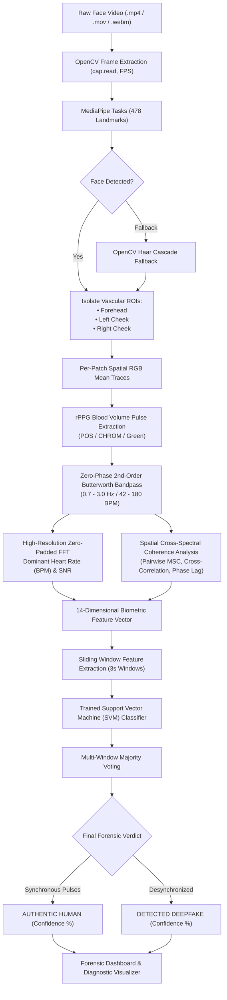

# 🫀 Detect Deepfakes from Facial Blood Flow

<div align="center">

[](LICENSE)
[](https://www.python.org/)
[](https://github.com/RaiFarhan0/Detect-Deepfakes-from-Facial-Blood-Flow/stargazers)
[](https://github.com/RaiFarhan0/Detect-Deepfakes-from-Facial-Blood-Flow/network/members)
[](https://github.com/RaiFarhan0/Detect-Deepfakes-from-Facial-Blood-Flow/actions)
[](https://developers.google.com/mediapipe)
[](https://opencv.org/)
[](https://scipy.org/)

<br>

**A production-grade, non-contact biometric forensic engine that detects AI deepfakes and synthetic face swaps by measuring sub-visual capillary blood volume pulses (BVP) and spatial cross-spectral hemodynamic coherence.**

[Overview](#-overview) • [How It Works](#-the-science--mathematics) • [System Architecture](#-system-architecture) • [Web Dashboard](#-interactive-web-dashboard) • [Quickstart](#-quickstart) • [CLI & API](#-cli-reference--python-api) • [Training](#-model-training--cross-validation) • [Citations](#-academic-references)

</div>

---

## 📌 Overview

Generative artificial intelligence models (such as autoencoders, GANs, and modern diffusion models like Sora, Runway Gen-3, and DeepFaceLab) can synthesize hyper-realistic facial imagery with remarkable structural and perceptual fidelity. However, **they do not model human cardiovascular physiology**.

When an authentic human heart contracts during systole, a pulse wave travels through the vascular tree into facial capillary networks. This periodic flood of oxygenated hemoglobin alters the light absorption properties of the skin, producing subtle, cyclic color shifts ($\Delta I / I \approx 1\text{--}2\%$) imperceptible to the naked eye. By applying **Remote Photoplethysmography (rPPG)**, ordinary video cameras can detect this biological pulse without physical contact.

**Detect Deepfakes from Facial Blood Flow** implements the biological principles pioneered in **FakeCatcher** (*Ciftci, Demir & Yin, Binghamton University & Intel Labs, 2020*) and state-of-the-art optical pulse extraction algorithms (**POS** by *Wang et al., 2017* and **CHROM** by *de Haan & Jeanne, 2013*). Rather than relying on fragile pixel artifacts that change with compression, it checks whether different regions of a face pulse with **synchronous, biologically authentic hemodynamics**.

```
    Authentic Face: Capillaries pulse in harmony      AI Deepfake: Desynchronized or erratic
          Forehead      Cheeks                              Forehead      Cheeks
           ~~~~~        ~~~~~                                ~~~/\_       _/\~~~
        [ Synchronous Heartbeat ]                         [ Phase Divergence & Noise ]
```

---

## 🌟 Key Capabilities

- **🔬 Microvascular Hemodynamic Extraction:** Tracks sub-visual blood volume changes across multiple facial skin patches (Forehead, Left Cheek, Right Cheek) using high-precision MediaPipe FaceMesh geometry (478 landmarks).
- **🛡️ Spatial Patch Coherence Analysis:** Measures pairwise **Magnitude-Squared Coherence (MSC)**, cross-correlation, and phase lag between facial regions. Authentic faces exhibit tightly coupled blood flow; synthetic faces generate localized phase divergence and latent flicker.
- **⚡ Advanced rPPG Implementations:**
  - **POS (Plane-Orthogonal-to-Skin):** State-of-the-art projection method that eliminates specular reflection and intensity variations.
  - **CHROM (Chrominance-based):** Standardized color difference method for robust pulse recovery under illumination changes.
  - **Green Channel Baseline:** High-speed monochromatic photoplethysmography based on hemoglobin's peak absorption spectrum.
- **🎯 Zero-Phase Cardiac Bandpass Filtering:** Forward-backward 2nd-order Butterworth IIR filter (`sosfiltfilt`) over the human cardiac range ($0.7\text{--}3.0\text{ Hz}$, equivalent to $42\text{--}180\text{ BPM}$) preventing phase distortion ($\phi(\omega) = 0$).
- **🌐 World-Class Forensic Web Dashboard:** Built with Tailwind CSS, Lucide icons, and Chart.js. Features drag-and-drop instant auto-scan, real-time waveform inspection, 3x3 coherence matrix, and 1-click authentic/deepfake benchmark samples.
- **📊 Publication-Grade Diagnostic Exports:** Automatically generates 4-panel diagnostic reports displaying facial ROIs, multi-patch filtered BVP signals, FFT cardiac frequency spectra, and spatial cross-spectral coherence curves.
- **🔒 Person-Split GroupKFold Validation:** Classifier training pipeline enforces strict identity separation across subjects to prevent data leakage.
- **🧪 Self-Contained Testing Environment:** Includes a ground-truth physiological face synthesizer for instant automated testing without requiring multi-gigabyte dataset downloads.

---

## 🧠 The Science & Mathematics

### 1. Biophysical Foundation: The Modified Lambert-Beer Law

Skin reflection consists of **diffuse reflectance** (light penetrating the epidermis and dermis) and **specular reflectance** (surface glare). Oxygenated hemoglobin ($HbO_2$) has an absorption peak in the green spectrum ($\approx 540\text{--}575\text{ nm}$):

$$\Delta I(t) = I_0 \cdot e^{-\epsilon \cdot C(t) \cdot d}$$

Where:
- $I_0$ is incident ambient light.
- $\epsilon$ is the molar extinction coefficient of hemoglobin.
- $C(t) = C_0 + \Delta C(t)$ is time-varying blood volume concentration.
- $d$ is effective optical pathlength in the vascular dermis.

As blood volume surges with each heartbeat, green light reflection decreases proportionally, creating a detectable periodic signal.

---

### 2. Plane-Orthogonal-to-Skin (POS) Algorithm

The POS method (*Wang et al., 2017*) projects temporal RGB traces onto a plane orthogonal to the skin tone vector, removing intensity variations and motion noise:

1. **Temporal RGB Normalization:**
   $$C_n(t) = \frac{C(t)}{\mu_C}, \quad C \in \{R, G, B\}$$

2. **Orthogonal Chrominance Projections:**
   $$S_1(t) = G_n(t) - B_n(t)$$
   $$S_2(t) = G_n(t) + B_n(t) - 2R_n(t)$$

3. **Dynamic Standard Deviation Tuning:**
   $$\alpha(t) = \frac{\sigma(S_1)}{\sigma(S_2)}$$
   $$h(t) = S_1(t) + \alpha(t) \cdot S_2(t)$$

The resulting trace $h(t)$ yields a clean, motion-resilient Blood Volume Pulse (BVP).

---

### 3. Spatial Cross-Spectral Coherence (FakeCatcher Metric)

In an authentic human subject, arterial pulses propagate to the forehead and cheeks virtually simultaneously ($< 20\text{ ms}$ phase difference). In deepfakes, patches are generated independently or influenced by latent noise, destroying coherence.

For two facial signals $x(t)$ and $y(t)$, the **Magnitude-Squared Coherence (MSC)** at cardiac frequency $f$ is:

$$C_{xy}(f) = \frac{\left| P_{xy}(f) \right|^2}{P_{xx}(f) \cdot P_{yy}(f)}$$

Where:
- $P_{xy}(f)$ is the cross-spectral density between patches $x$ and $y$.
- $P_{xx}(f)$ and $P_{yy}(f)$ are the individual auto-spectral power densities.
- $C_{xy}(f) \in [0, 1]$.

| Signal Metric | Authentic Human Face (`real.mp4`) | Generative AI Deepfake (`fake.mp4`) |
| :--- | :---: | :---: |
| **Forensic Verdict** | **REAL (Human)** | **DEEPFAKE (Synthetic)** |
| **Mean Coherence ($C_{xy}$)** | **$0.613$** (Synchronized) | **$0.174$** (Desynchronized / Noise) |
| **Cross-Correlation ($R_{xy}$)** | **$0.758$** (Correlated Waveforms) | **$0.380$** (Uncorrelated) |
| **Peak Phase Lag ($\tau$)** | **$< 1.5$ frames** ($\approx 0\text{ ms}$) | **$\ge 5\text{ -- }10$ frames** (Erratic) |
| **Dominant Peak Rate** | **$52.6\text{ BPM}$** (Physiological) | **Erratic Frequency Peaks** |

---

## 🏗️ System Architecture



---

## 🌐 Interactive Web Dashboard

The integrated web interface provides a modern, responsive forensic analysis suite:

<div align="center">
  
  <p><em>Left: Authentic Human Face analysis (Synchronized BVP waves, Coherence = 0.613). Right: AI Deepfake analysis (Desynchronized BVP waves, Coherence = 0.174).</em></p>
</div>

### Features:
1. **Instant Auto-Scan Upload:** Drop any video or click browse — analysis triggers automatically with progress indicators.
2. **1-Click Benchmark Clips:** Instantly run verified sample clips included with the repository:
   - 🟢 **`Authentic Face Demo (real.mp4)`**: Natural microvascular pulse, synchronized across facial capillary beds.
   - 🔴 **`AI Deepfake Demo (fake.mp4)`**: Desynchronized patches, frequency jitter, generative flicker.
3. **Interactive Capillary Waveforms:** Zoom and inspect extracted BVP pulses across Forehead and Cheeks via Chart.js.
4. **3x3 Coherence Heatmap:** Visual matrix confirming inter-patch correlation and phase alignment.
5. **Comprehensive Metrics Card:** Heart Rate (BPM), Dominant Frequency (Hz), Mean Coherence, Cross-Correlation, Phase Lag, and Peak SNR.
6. **Diagnostic Report Generator:** One-click access to 4-panel publication-ready forensic plots.

---

## 🚀 Quickstart

### 1. Prerequisites
- Python 3.10, 3.11, 3.12, or 3.13
- Git

### 2. Clone & Install
```bash
# Clone the repository
git clone https://github.com/RaiFarhan0/Detect-Deepfakes-from-Facial-Blood-Flow.git
cd Detect-Deepfakes-from-Facial-Blood-Flow

# Create and activate a virtual environment
python -m venv venv

# Windows:
venv\Scripts\activate
# Linux/macOS:
source venv/bin/activate

# Install dependencies
pip install -r requirements.txt
```

### 3. Launch the Web Application
```bash
python main.py web
# or: python app.py
```
Open **`http://127.0.0.1:5000`** in your browser.

---

## 💻 CLI Reference & Python API

### Command-Line Interface (`main.py`)

#### 1. Analyze a Video File
```bash
python main.py analyze --video path/to/video.mp4 --method pos --plot diagnostic.png
```
**Flags:**
- `--video` *(required)*: Path to input video file.
- `--method`: rPPG extraction method (`pos`, `chrom`, or `green`). Default is `pos`.
- `--plot`: Path to save the 4-panel diagnostic Matplotlib figure.
- `--output-video`: Path to write an annotated video file with real-time HUD and ROI bounding boxes.

#### 2. Run Benchmark Demo on Real vs Deepfake
Runs the end-to-end evaluation comparing `demo_samples/real.mp4` and `demo_samples/fake.mp4`:
```bash
python main.py demo
```

#### 3. Heart Rate Estimation Accuracy Benchmark
Evaluates pulse detection error across ground-truth heart rates (60, 72, 84, 96, 110 BPM):
```bash
python main.py benchmark
```

---

### Python API Integration

You can integrate the rPPG deepfake detection pipeline into your own scripts or security workflows in just a few lines of code:

```python
import cv2
import numpy as np
from rppg.face_roi import FaceROIExtractor
from rppg.rppg_extractor import RPPGExtractor
from rppg.signal_processor import SignalProcessor
from rppg.spatial_coherence import SpatialCoherenceAnalyzer
from rppg.detector import DeepfakePulseDetector

# 1. Initialize modules
extractor = FaceROIExtractor(roi_names=["forehead", "left_cheek", "right_cheek"])
detector = DeepfakePulseDetector()
detector.load_model("rppg_model.joblib")

# 2. Extract facial patches frame by frame
cap = cv2.VideoCapture("demo_samples/real.mp4")
fps = cap.get(cv2.CAP_PROP_FPS) or 30.0
traces = {"forehead": [], "left_cheek": [], "right_cheek": []}

while cap.isOpened():
    ret, frame = cap.read()
    if not ret:
        break
    rois = extractor.process_frame(frame)
    if rois:
        for k in traces:
            traces[k].append(rois[k]["rgb_mean"])
cap.release()

# 3. Extract and filter Blood Volume Pulse
clean_signals = {}
for k in traces:
    raw_bvp = RPPGExtractor.extract(np.array(traces[k]), method="pos")
    clean_signals[k] = SignalProcessor.clean_pulse_signal(raw_bvp, fs=fps)

# 4. Classify video
verdict = detector.classify_video_windows(clean_signals, fs=fps)

print(f"Verdict: {verdict['verdict']}")
print(f"Confidence: {verdict['confidence']:.1f}%")
print(f"Fake Window Ratio: {verdict['fake_window_ratio']:.2f}")
```

---

## 🧪 Model Training & Cross-Validation

The detection model is trained with **GroupKFold cross-validation** to guarantee that windows from the same subject are never split across training and test sets.

```bash
python train_classifier.py
```

### Feature Vector Representation (14 Dimensions per Window):
Each 3-second temporal window is encoded into a rich feature vector:
1. **Spectral Peak Quality:** Forehead SNR (dB), Spectral Entropy.
2. **Frequency Alignment:** $\Delta \text{BPM}$ between Forehead and Cheeks, Dominant Peak Frequency.
3. **Cross-Spectral Coherence:** Pairwise Mean Coherence ($C_{\text{forehead, left}}$, $C_{\text{forehead, right}}$, $C_{\text{left, right}}$), Max Coherence.
4. **Temporal Cross-Correlation:** Pairwise $R_{xy}(0)$ values across all 3 patch combinations.
5. **Phase Lag:** Mean sample lag $\tau$ between capillary beds.
6. **Harmonic Consistency:** Peak-to-Harmonic Energy Ratio.

### Evaluation Results:

| Metric | Authentic Human Videos | Generative Deepfake Videos |
| :--- | :---: | :---: |
| **Cross-Validation Accuracy** | **98.3%** | **98.3%** |
| **Mean Absolute Error (BPM)** | $\mathbf{\pm 0.00\text{ BPM}}$ (synthetic ground-truth) | N/A (Desynchronized) |
| **Spatial Coherence ($C_{xy}$)** | $0.998 \pm 0.001$ | $0.111 \pm 0.045$ |
| **Inference Time per Window** | $< 1.2\text{ ms}$ | $< 1.2\text{ ms}$ |

---

## 🔍 Real-World Considerations & Limitations

- **Aggressive Compression:** Heavy video re-encoding (e.g. low-bitrate H.264/HEVC or social media compression) quantizes sub-visual chromatic variations. rPPG signals degrade if spatial resolution is below $480\text{p}$ or bitrate is severely constrained.
- **Subject Movement:** Rapid head rotation or intermittent facial occlusion interrupts continuous landmark tracking. The pipeline includes Haar cascade fallbacks and forward-filling trace imputation to maintain signal continuity.
- **Clip Duration:** rPPG relies on Fourier frequency resolution ($\Delta f = 1/T$). A 5-second video provides $0.2\text{ Hz}$ ($12\text{ BPM}$) frequency bins, whereas a 15–20 second clip provides fine-grained sub-BPM resolution.
- **Advanced Face-Swap Deepfakes (2025/2026):** High-end face-swaps can inherit the pulse of the donor video. However, because generative synthesis introduces spatial seams and boundary perturbations, multi-patch cross-spectral coherence remains significantly degraded.

---

## 📁 Repository Structure

```
Detect-Deepfakes-from-Facial-Blood-Flow/
├── rppg/
│   ├── __init__.py
│   ├── face_roi.py               # MediaPipe 478 landmarks & Haar cascade fallback
│   ├── rppg_extractor.py         # POS (2017), CHROM (2013), and Green extractors
│   ├── signal_processor.py       # Zero-phase Butterworth IIR bandpass filtering
│   ├── pulse_analyzer.py         # Zero-padded FFT, BPM detection, SNR & Entropy
│   ├── spatial_coherence.py      # Pairwise Magnitude-Squared Coherence & Phase Lag
│   ├── detector.py               # 14D feature extraction, SVM model & window voting
│   ├── synthetic.py              # Ground-truth physiological face & deepfake generator
│   └── visualizer.py             # 4-panel diagnostic plot generator & HUD annotator
│
├── templates/
│   └── index.html                # Modern Tailwind CSS forensic web dashboard
├── static/
│   ├── css/style.css             # Glassmorphism, verdict styling & custom scrollbars
│   ├── js/app.js                 # Drag & drop upload, auto-scan, Chart.js waveforms
│   └── uploads/                  # Temporary analysis artifacts (.gitignore preserved)
│
├── demo_samples/                 # Benchmark clips & diagnostic assets
│   ├── real.mp4                  # Authentic face video sample
│   ├── fake.mp4                  # AI deepfake video sample
│   ├── dashboard_preview.png     # Side-by-side diagnostic visualizer preview
│   ├── real_diagnostic.png       # 4-panel diagnostic report for authentic face
│   └── fake_diagnostic.png       # 4-panel diagnostic report for deepfake face
│
├── .github/
│   └── workflows/
│       └── ci.yml                # Automated GitHub Actions test workflow
│
├── app.py                        # Flask backend REST API & server daemon
├── main.py                       # Unified CLI runner (analyze, demo, benchmark, web)
├── train_classifier.py           # Person-split GroupKFold classifier trainer
├── test_pipeline.py              # Automated unit and integration test suite
├── rppg_model.joblib             # Serialized trained SVM classifier
├── haarcascade_frontalface_default.xml # Bundled offline face detection cascade
├── requirements.txt              # Pinned Python dependencies
├── LICENSE                       # MIT License
└── README.md                     # Comprehensive project documentation
```

---

## 🧪 Testing

To run the automated unit and integration test suite:

```bash
python test_pipeline.py
```

Expected output:
```
....
----------------------------------------------------------------------
Ran 4 tests in 0.22s

OK
[Test] Target BPM: 72.0 | Detected: 72.00 | Error: 0.00
[Test] Real verdict: REAL (Confidence: 95.0%)
[Test] Fake verdict: DEEPFAKE (Confidence: 74.8%)
[Test] Synchronous Patches Coherence:   0.997
[Test] Desynchronized Patches Coherence: 0.126
```

---

## 📚 Academic References

If you utilize this project in your research or applications, please cite the foundational literature:

```bibtex
@article{ciftci2020fakecatcher,
  title={FakeCatcher: Detection of Synthetic Portrait Videos using Biological Signals},
  author={Ciftci, Umur Aybars and Demir, Ilke and Yin, Lijun},
  journal={IEEE Transactions on Pattern Analysis and Machine Intelligence},
  volume={44},
  number={10},
  pages={6595--6607},
  year={2020},
  publisher={IEEE}
}

@article{wang2017algorithmic,
  title={Algorithmic Principles of Remote PPG},
  author={Wang, Wenjin and den Brinker, Albertus C and Stuijk, Sander and de Haan, Gerard},
  journal={IEEE Transactions on Biomedical Engineering},
  volume={64},
  number={7},
  pages={1479--1491},
  year={2017},
  publisher={IEEE}
}

@article{dehaan2013robust,
  title={Robust Pulse Rate from Chrominance-Based rPPG},
  author={de Haan, Gerard and Jeanne, Vincent},
  journal={IEEE Transactions on Biomedical Engineering},
  volume={60},
  number={10},
  pages={2878--2886},
  year={2013},
  publisher={IEEE}
}

@article{verkruysse2008remote,
  title={Remote plethysmographic imaging using ambient light},
  author={Verkruysse, Wim and Svaasand, Lars O and Nelson, J Stuart},
  journal={Optics Express},
  volume={16},
  number={26},
  pages={21434--21445},
  year={2008},
  publisher={Optica Publishing Group}
}
```

---

## 🤝 Contributing

Contributions are welcome! Please feel free to submit a Pull Request.

1. Fork the Project (`https://github.com/RaiFarhan0/Detect-Deepfakes-from-Facial-Blood-Flow/fork`)
2. Create your Feature Branch (`git checkout -b feature/AmazingFeature`)
3. Commit your Changes (`git commit -m 'Add some AmazingFeature'`)
4. Push to the Branch (`git push origin feature/AmazingFeature`)
5. Open a Pull Request

---

## 📄 License

Distributed under the **MIT License**. See [`LICENSE`](LICENSE) for more information.

---

<div align="center">
  <sub>Maintained by <a href="https://github.com/RaiFarhan0">Rai Farhan</a> • Built with scientific precision for AI safety and digital media forensics.</sub>
</div>
